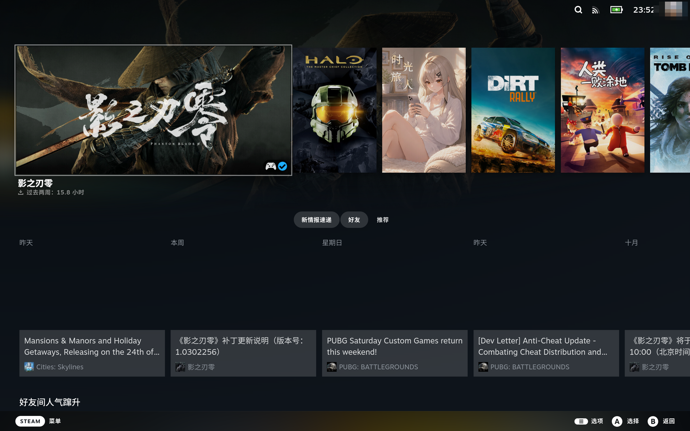

# J716F SteamOS — a SteamOS-like system on the Lenovo Xiaoxin Pad Pro 2021

Turn a **Lenovo Xiaoxin Pad Pro 2021 (TB-J716F, Snapdragon 870 / SM8250-AC, 8 GB + 128 GB)** into a
handheld-style tablet running **Arch Linux ARM + gamescope + Steam Big Picture (Steam-ARM)**.

> This repo packages a long real-device bring-up (Oct 2026 – Nov 2026): reproducible scripts, configs,
> image build/release tooling and detailed notes. Not affiliated with Lenovo or Valve.
> No Valve client binaries and no user account data are included.



[中文](README.md) · [Quick start](#quick-start) · [Repository layout](#repository-layout) · [Known issues](#known-issues) · [Screenshots](docs/screenshots.md)

---

## Features

| Feature | Status | Notes |
|---|---|---|
| Boot | ✅ | ABL → `boot_a/boot_b` Android boot.img (kernel + custom initramfs + DTB) → Arch rootfs on `sda18` |
| Display | ✅ | Dual DSI `rm69380` AMOLED, 2560×1600@60 Hz, KMS/DPU patches |
| Touch / keyboard / trackpad | ✅ | Goodix touch, i2c-hid keyboard cover and trackpad |
| Audio (speakers) | ✅ | 4× CS35L41 + ALSA UCM (`J716F-HiFi.conf`) |
| Wi-Fi / Bluetooth | ✅ | WCN6855/ath11k; BlueZ 5.72 (5.87 has issues) |
| Charging / thermals | ✅ | SMB5 fast charging + charge thermal service |
| Game Mode | ✅ | greetd + gamescope (DRM direct scanout) + Steam Big Picture |
| Steam (native ARM64) | ✅ | Valve ARM64 client installed via the community Steam-ARM project (not bundled in releases) |
| x86 games | ✅/⚠️ | FEX-Emu translation; light/2D games work, heavy 3D is limited by CPU translation |
| Camera | ⚠️ | Partially working (camera daemons + udev rules) |
| Built-in microphone | ❌ | Documented dead end: ES7210 array blocked by DSP MI2S (use a USB mic) |
| Halo MCC etc. | ❌ | ARM64 Proton compatibility issues |

**Key engineering points** (see docs):

- **ABL A/B retry counter**: Qualcomm A/B state lives in **GPT partition attribute bits** (not misc/RPMB).
  Running [qbootctl](https://github.com/linux-msm/qbootctl) `-m` on every boot marks the slot successful and
  permanently fixes the "fastboot after ~7 reboots" problem. → [`docs/83`](docs/83-ABL计数彻底解决.md)
- **Card-flash without a PC**: a custom **mini-recovery** written to the unused `recovery_a/recovery_b`,
  entered via the `misc` BCB `boot-recovery` command, flashes payloads from `/j716f/` on SD/USB. → [`docs/84`](docs/84-线刷卡刷双路线.md)
- **Release images**: `boot.img` + `rootfs.img.gz` (card-flash) / `rootfs.simg` (fastboot sparse) +
  Windows installer. → [`docs/82`](docs/82-刷机包发布方案.md) / [`docs/85`](docs/85-发布版构建手册.md)
- **Custom username on first boot**: build-time rename to placeholder `player`, fixed home `/home/j716f`,
  first-boot setup lets each user choose their own login name/password. → [`docs/86`](docs/86-用户名通用化与首启自定义.md)

## Hardware / software baseline

- Device: TB-J716F (Lenovo Xiaoxin Pad Pro 2021), SM8250-AC, Adreno 650, 8 GB RAM / 128 GB UFS
- OS: Arch Linux ARM (aarch64), kernel 6.13.0-sm8250 (self-maintained tree), systemd
- Graphics: Mesa Turnip (Adreno 650) + Vulkan + gamescope 3.17
- Desktop: none (pure Game Mode + SSH; text console and rescue kept)
- Release layout: same image on `boot_a`/`boot_b`, rootfs on `userdata` (`sda18`); vendor/calibration
  partitions (`persist`, `modem`, `modemst*`, `fsg`, …) are never touched

## Quick start

### Route A — use a release image

1. Device must be **TB-J716F** with an **unlocked bootloader**;
2. Download a line-flash package from the Releases page;
3. On Windows run `install.ps1` (this erases all data);
4. First boot: choose your username/password → configure Wi-Fi → install Steam (releases do not bundle it).

See [`release/README-TEMPLATE.md`](release/README-TEMPLATE.md) and [`docs/85`](docs/85-发布版构建手册.md).

### Route B — build a release image from a running device

Requires a working same-model device reachable over SSH:

```bash
# on the device (root)
sudo /home/yp/release-assets/build-rootfs.sh --inspect        # review what will be cleaned
sudo /home/yp/release-assets/build-rootfs.sh --strip-steam    # release build (no Valve client)
# outputs: /mnt/sdcard/j716f-release/{boot.img,rootfs.img.gz,rootfs.simg,SHA256SUMS}
```

→ [`docs/85`](docs/85-发布版构建手册.md) / [`docs/86`](docs/86-用户名通用化与首启自定义.md)

### Route C — card-flash (device already has mini-recovery)

```bash
# payload at /j716f/{boot.img,rootfs.img.gz,SHA256SUMS} on SD card
sudo j716f-reboot-recovery
```

→ [`docs/84`](docs/84-线刷卡刷双路线.md)

## Repository layout

```
j716f-steamos/
├─ docs/            # bring-up notes and plans (start with 75 / 83 / 84 / 85 / 86)
│  ├─ images/       # screenshots and generated diagrams
│  └─ device/       # per-topic notes (Bluetooth, battery slots, charging, camera…)
├─ scripts/         # on-device scripts (gamemode/display/volume keys/SD mount/thermal…)
├─ configs/         # systemd units, greetd, udev rules, ALSA UCM
├─ recovery/        # mini-recovery (init / recovery.sh / builder)
├─ release/         # release tooling (rootfs image, first boot, user setup, Steam installer, Windows installer)
├─ tools/           # host/device tools (GPT slot analyzer, BCB writer, card-flash packer…)
└─ kernel/          # kernel 6.13 device patch set + config + DTB; 6.15.11 upstream patch snapshot
```

## Kernel

The running kernel is **6.13.0-sm8250**. The repo ships the device patch set against upstream **v6.13**,
the exact `.config`, all changed/new source files under `kernel/linux-6.13-j716f/src/`, DTB sources and a
build script. The upstream tarball URL + SHA-256 are pinned in `UPSTREAM.md`, and `build.sh` reproduces the
kernel in one command. A full kernel tree can be materialized with `import-full-tree.sh` (gitignored by
default); the in-repo full-tree option and its size trade-offs are documented in
[`kernel/README.md`](kernel/README.md). No separate repo/submodule is required.

## Documentation

| Doc | Content |
|---|---|
| [docs/87](docs/87-仓库导读与代码结构.md) | repo tour, reading paths, data flow, deploy scripts/configs |
| [docs/88](docs/88-内核与启动镜像详解.md) | partitions, boot.img, initramfs, DTB, A/B slots, repack/flash |
| [docs/89](docs/89-FAQ与排障.md) | FAQ: boot, Steam, audio, network, flashing, performance |
| [docs/90](docs/90-性能调优与兼容性.md) | CPU/GPU/memory/thermal/charging, game compatibility, test matrix |
| [docs/83](docs/83-ABL计数彻底解决.md) | ABL A/B retry counter fix (GPT attrs + qbootctl) |
| [docs/84](docs/84-线刷卡刷双路线.md) | fastboot / TWRP zip / mini-recovery card-flash |
| [docs/85](docs/85-发布版构建手册.md) / [docs/86](docs/86-用户名通用化与首启自定义.md) | release image build & first-boot username setup |
| [scripts/README.md](scripts/README.md), [configs/README.md](configs/README.md) | on-device scripts and system configs |
| [release/README.md](release/README.md), [recovery/README.md](recovery/README.md), [tools/README.md](tools/README.md) | release tooling, mini-recovery, helper tools |

## Known issues / limitations

- **Performance**: Snapdragon 870 translating x86 is the bottleneck; heavy 3D games are not realistic.
  Prefer ARM-native / 2D / indie games or game streaming.
- **Built-in microphone**: unusable (hardware/DSP limitation); use a USB microphone.
- **Halo MCC / some Windows games**: ARM64 Proton compatibility.
- **CPU 3.2 GHz / GPU 670 MHz**: experimental, not long-term stable; stable baseline is the default.
- **ABL slot flags**: do not use `qbootctl -s` to switch slots (it overwrites the retry bits); the release
  service only calls `-m`.
- **Steam is not bundled** in releases for licensing reasons; install it on first boot.

## Legal

- Original code (scripts/tools/recovery/release) is MIT; docs are CC BY-SA 4.0. Third-party components keep
  their own licenses.
- **No Valve Steam client files, no Steam account data, no Lenovo factory firmware, no third-party personal data.**
- Kernel is GPL-2.0: patches, config and build scripts are provided; see `kernel/` and release notes.
- Qualcomm firmware (`/lib/firmware/qcom/*`) is proprietary and not included in this repo; see
  [`release/NOTICE-SOURCE.md`](release/NOTICE-SOURCE.md).
- Flashing is risky (brick/warranty/data loss), TB-J716F only, use at your own risk.

## Credits

- [Steam-ARM](https://github.com/Scrumpper/Steam-ARM) — Valve ARM64 Steam client packaging/FEX
- [qbootctl](https://github.com/linux-msm/qbootctl) — Qualcomm bootctl HAL port for Linux
- [postmarketOS wiki: Android A/B slots](https://wiki.postmarketos.org/wiki/Android_AB_Slots)
- [Arch Linux ARM](https://archlinuxarm.org/)
- [gamescope](https://github.com/ValveSoftware/gamescope) / [MangoHud](https://github.com/flightlessmango/MangoHud)
- Linux kernel community and the `j716f-ubuntu` patch set (see `kernel/`)

## License

- Code: MIT (see [LICENSE](LICENSE))
- Docs: CC BY-SA 4.0
