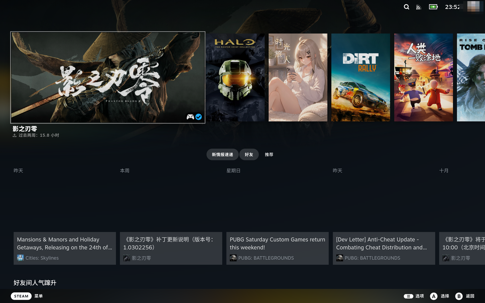

# J716F SteamOS — Lenovo Xiaoxin Pad Pro 2021 上的 SteamOS 风格系统

把 **Lenovo Xiaoxin Pad Pro 2021（TB-J716F，骁龙 870 / SM8250-AC / 8G+128G）** 改造成一台
**Arch Linux ARM + gamescope + Steam Big Picture（Steam-ARM）** 的掌机式平板。

> 本仓库整理自一台实机的长期改造过程（2026-10 至 2026-11），包含可复现的脚本、配置、镜像构建/发布工具和踩坑文档。
> 不隶属于联想（Lenovo）或 Valve；不包含 Valve 客户端文件或他人 Steam 账号数据。



[English](README.en.md) · [快速开始](#快速开始) · [仓库结构](#仓库结构) · [已知问题](#已知问题) · [截图](docs/screenshots.md)

---

## 已实现的功能

| 功能 | 状态 | 说明 |
|---|---|---|
| 启动 | ✅ | ABL → `boot_a/boot_b` 的 Android boot.img（kernel + 定制 initramfs + DTB）→ Arch rootfs `sda18` |
| 显示 | ✅ | 双 DSI `rm69380` AMOLED，2560×1600@60Hz，KMS/DPU 补丁 |
| 触摸 / 键盘 / 触控板 | ✅ | Goodix 触摸、i2c-hid 键盘保护套与触控板 |
| 音频（扬声器） | ✅ | CS35L41 四单元 + ALSA UCM（`J716F-HiFi.conf`） |
| WiFi / 蓝牙 | ✅ | WCN6855/ath11k；BlueZ 5.72（5.87 有问题） |
| 充电 / 温控 | ✅ | SMB5 快充 + 充电温控服务 |
| Game Mode | ✅ | greetd + gamescope（DRM 直出）+ Steam Big Picture |
| Steam（ARM64 原生） | ✅ | 通过社区项目 Steam-ARM 安装 Valve ARM64 客户端（发布版不随包） |
| x86 游戏 | ✅/⚠️ | FEX-Emu 转译；轻量/2D 可玩，3D 大作受 CPU 转译限制 |
| 相机 | ⚠️ | 部分可用（camera daemon + udev 规则） |
| 内置麦克风 | ❌ | 已归档结论：ES7210 阵列被 DSP MI2S 占用（用 USB 麦克风） |
| Halo MCC 等 | ❌ | ARM64 Proton 兼容性问题 |

**关键工程点**（文档里有完整记录）：

- **ABL 槽位重试计数**：Qualcomm A/B 状态在 **GPT 分区属性字节**里（不在 misc/RPMB）。用
  [qbootctl](https://github.com/linux-msm/qbootctl) 每次启动 `-m` 标记成功即可，彻底解决"重启 7 次进 fastboot"。→ [`docs/83`](docs/83-ABL计数彻底解决.md)
- **卡刷（无 PC 更新/重装）**：自建 **mini-recovery** 写入空闲的 `recovery_a/recovery_b`，通过 `misc` 的 BCB
  `boot-recovery` 从系统内重启进入，从 SD/USB 的 `/j716f/` payload 刷写。→ [`docs/84`](docs/84-线刷卡刷双路线.md)
- **线刷发布包**：`boot.img` + `rootfs.img.gz`（卡刷）/ `rootfs.simg`（fastboot sparse）+ Windows 安装脚本。→ [`docs/82`](docs/82-刷机包发布方案.md) / [`docs/85`](docs/85-发布版构建手册.md)
- **发布版用户名可自定义**：构建时 `player`→占位 `player`、家目录固定 `/home/j716f`；首启 setup 让用户输入自己的登录名/密码。→ [`docs/86`](docs/86-用户名通用化与首启自定义.md)

## 硬件 / 软件基线

- 设备：TB-J716F（Lenovo Xiaoxin Pad Pro 2021），SM8250-AC，Adreno 650，8G RAM / 128G UFS
- 系统：Arch Linux ARM（aarch64），内核 6.13.0-sm8250（自维护树），systemd
- 图形：Mesa Turnip（Adreno 650）+ Vulkan + gamescope 3.17
- 桌面环境：无（纯 Game Mode + SSH；保留文本控制台）
- 镜像发布：`boot_a/boot_b` 双槽同镜像 + `userdata`(sda18) 根文件系统，不覆盖 `persist/modem/…` 设备唯一分区

## 快速开始

### 路线 A：用发布包（小白/朋友）

1. 设备需是 **TB-J716F** 且 **bootloader 已解锁**；
2. 从发布页（GitHub Releases）下载线刷包；
3. Windows 上运行 `install.ps1`（会清空数据）；
4. 首次开机自定义用户名/密码 → 配网 → 安装 Steam（发布版不含 Valve 客户端）。

细节见 [`release/README-TEMPLATE.md`](release/README-TEMPLATE.md) 与 [`docs/85`](docs/85-发布版构建手册.md)。

### 路线 B：从当前设备构建发布镜像

需要一台已经跑起来的同型号设备（通过 SSH 连上），然后：

```bash
# 设备上（root）
sudo /home/j716f/release-assets/build-rootfs.sh --inspect        # 先看清理目标
sudo /home/j716f/release-assets/build-rootfs.sh --strip-steam    # 发布版（不含 Valve 客户端）
# 产物：/mnt/sdcard/j716f-release/{boot.img,rootfs.img.gz,rootfs.simg,SHA256SUMS}
```

→ [`docs/85`](docs/85-发布版构建手册.md) / [`docs/86`](docs/86-用户名通用化与首启自定义.md)

### 路线 C：卡刷（设备已装 mini-recovery）

```bash
# payload 放 SD 卡 /j716f/{boot.img,rootfs.img.gz,SHA256SUMS}
sudo j716f-reboot-recovery     # 自动重启进 recovery 刷写
```

→ [`docs/84`](docs/84-线刷卡刷双路线.md)

## 仓库结构

```
j716f-steamos/
├─ docs/            # 改造记录与方案（推荐先看 75/83/84/85/86）
│  └─ device/       # 设备问题专项记录（蓝牙、电池、快充、相机…）
├─ scripts/         # 设备端脚本（gamemode/display/音量键/SD 挂载/温控…）
├─ configs/         # systemd 单元、greetd、udev 规则、ALSA UCM
├─ recovery/        # mini-recovery（init / recovery.sh / 构建脚本）
├─ release/         # 发布构建工具（rootfs 镜像、首启、用户设置、Steam 安装器、Windows 安装器）
├─ tools/           # 宿主机/设备工具（GPT 槽位分析、BCB、卡刷打包、文档图片生成…）
└─ kernel/          # 6.13 当前内核（补丁+改动源码+config+DTB）与 6.15.11 历史快照
```

## 关键文档

| 文档 | 内容 |
|---|---|
| [docs/87-仓库导读与代码结构.md](docs/87-仓库导读与代码结构.md) | 按角色推荐阅读路径、目录说明、数据流、部署方法 |
| [docs/88-内核与启动镜像详解.md](docs/88-内核与启动镜像详解.md) | 分区/boot.img/initramfs/DTB/A-B 槽位/打包/刷写 |
| [docs/89-FAQ与排障.md](docs/89-FAQ与排障.md) | 启动、Steam、声音、网络、刷机、性能等常见问题 |
| [docs/90-性能调优与兼容性.md](docs/90-性能调优与兼容性.md) | CPU/GPU/内存/散热/充电/游戏兼容/测试矩阵 |
| [docs/75-稳定基线.md](docs/75-稳定基线.md) | 当前稳定配置清单（内核/包/服务/参数） |
| [docs/71-Arch-GameMode-实施记录.md](docs/71-Arch-GameMode-实施记录.md) | 从 Ubuntu 迁移到 Arch + Game Mode 的完整实施记录 |
| [docs/83-ABL计数彻底解决.md](docs/83-ABL计数彻底解决.md) | ABL 槽位计数：GPT 属性位 + qbootctl，实测记录 |
| [docs/84-线刷卡刷双路线.md](docs/84-线刷卡刷双路线.md) | 线刷/TWRP 兼容 zip/mini-recovery 卡刷 |
| [docs/85-发布版构建手册.md](docs/85-发布版构建手册.md) | 发布版 rootfs 清洗、镜像生成、Windows 安装器 |
| [docs/86-用户名通用化与首启自定义.md](docs/86-用户名通用化与首启自定义.md) | 用户名/家目录策略与首启 setup |
| [docs/ref-18.md](docs/ref-18.md) | 最早在 Ubuntu 上跑通 Steam Big Picture 的记录（历史） |
| [docs/screenshots.md](docs/screenshots.md) | 实机截图与启动链/分区/槽位/发布/卡刷流程图 |
| [kernel/README.md](kernel/README.md) | 6.13 设备补丁集、改动源码、config、DTB、构建与完整树说明 |
| [scripts/README.md](scripts/README.md) / [configs/README.md](configs/README.md) | 设备脚本与系统配置清单、部署方法 |
| [release/README.md](release/README.md) / [recovery/README.md](recovery/README.md) | 发布构建工具与 mini-recovery 使用说明 |
| [tools/README.md](tools/README.md) | 辅助工具清单与用法 |

## 已知问题 / 限制

- **性能**：骁龙 870 跑 x86 转译，3D 大作不现实；推荐 ARM 原生/2D/独立游戏或串流。
- **内置麦克风**：不可用（硬件/DSP 限制）；用 USB 麦克风。
- **Halo MCC / 部分 Windows 游戏**：ARM64 Proton 兼容性问题。
- **CPU 3.2GHz / GPU 670MHz**：实验性，长期稳定性未验证，默认用稳定基线。
- **ABL 槽位**：不要用 `qbootctl -s` 切槽（会覆盖 retry 位）；发布版服务只做 `-m`。
- **发布版不含 Steam 客户端**（合规），首启需联网安装。

## 法律与合规

- 本仓库的脚本/文档由项目作者以 MIT（代码）/ CC BY-SA 4.0（文档）发布；第三方组件遵循各自许可证。
- **不包含** Valve Steam 客户端文件、Steam 账号数据、联想原厂固件或他人数据。
- 内核为 GPLv2：对应源码/配置/补丁见 `kernel/` 与发布页说明。
- 高通固件（`/lib/firmware/qcom/*`）为专有文件，不在本仓库内；发布镜像中的来源与风险见 [`release/NOTICE-SOURCE.md`](release/NOTICE-SOURCE.md)。
- 刷机有风险（变砖/丢保修/数据清空），仅支持 TB-J716F，风险自负。

## 上传到 GitHub

本目录已经是一个带初始提交的 git 仓库（分支 `main`）。在装有 Git 的机器上：

```bash
cd j716f-steamos
git remote add origin https://github.com/<你的账号>/j716f-steamos.git
git push -u origin main
```

也可以直接用 GitHub Desktop 打开这个文件夹，或把文件夹拖进 GitHub 网页的“上传文件”。

## English summary

This repo documents and scripts a **SteamOS-like experience on the Lenovo Xiaoxin Pad Pro 2021 (TB-J716F, Snapdragon 870)**:
Arch Linux ARM userland, mainline-ish 6.13 kernel with device patches, gamescope + Steam Big Picture (Steam-ARM), and
reproducible release tooling (rootfs image build, fastboot package, in-device mini-recovery for SD-card flashing).
It also documents the Qualcomm ABL A/B retry-counter fix via GPT attributes + qbootctl, which stops the infamous
"fastboot after ~7 reboots" problem. No Valve client binaries or account data are included.

## Credits

- [Steam-ARM](https://github.com/Scrumpper/Steam-ARM) — Valve ARM64 Steam client packaging/FEX
- [qbootctl](https://github.com/linux-msm/qbootctl) — Qualcomm bootctl HAL port for Linux
- [postmarketOS wiki: Android A/B slots](https://wiki.postmarketos.org/wiki/Android_AB_Slots)
- [Arch Linux ARM](https://archlinuxarm.org/)
- [gamescope](https://github.com/ValveSoftware/gamescope) / [MangoHud](https://github.com/flightlessmango/MangoHud)
- Linux kernel community and the `j716f-ubuntu` patch set（见 `kernel/`）

## License

- 代码（`scripts/`、`tools/`、`recovery/`、`release/`）：MIT，见 [LICENSE](LICENSE)
- 文档（`docs/`）：CC BY-SA 4.0（转载/修改请保留出处）
