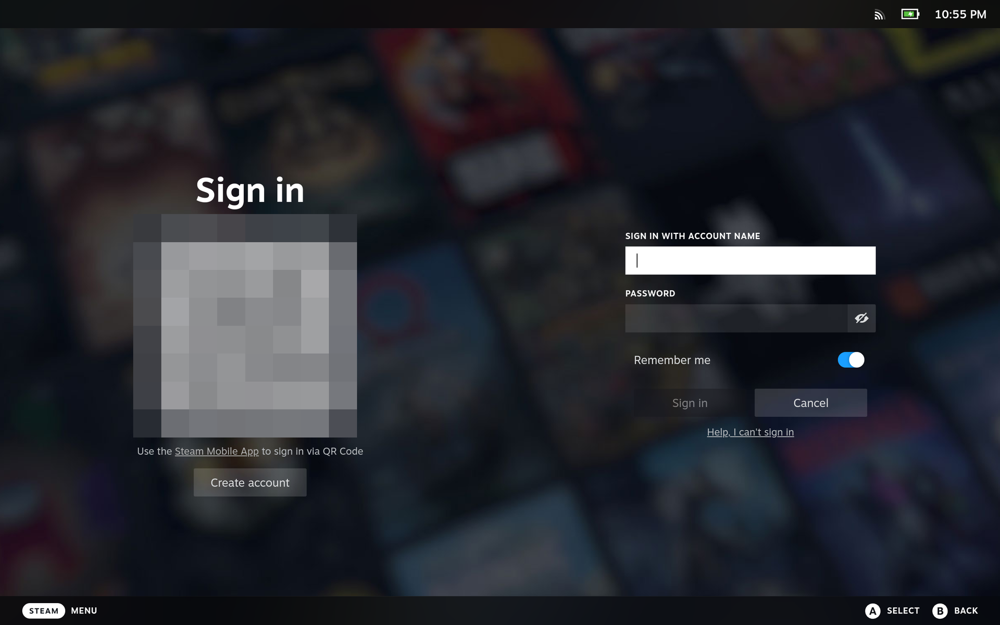
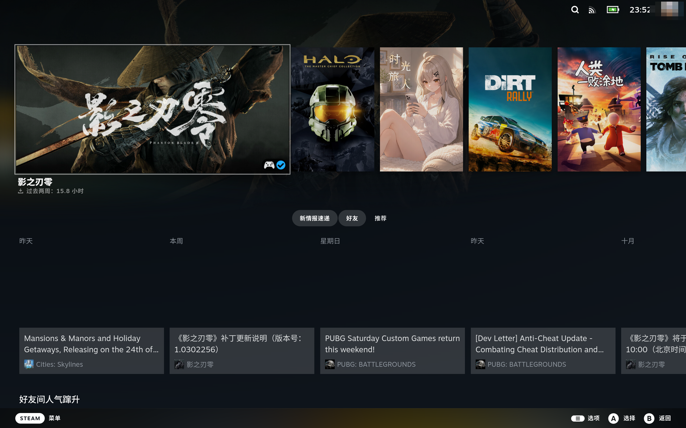
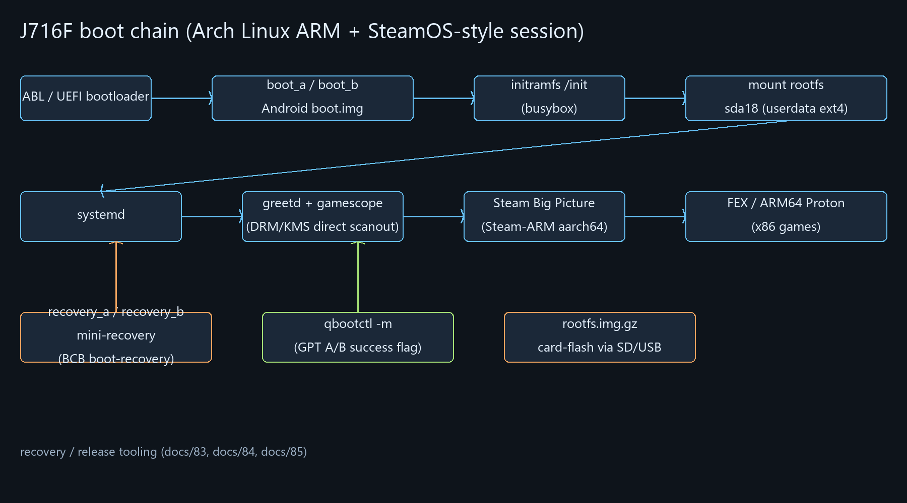
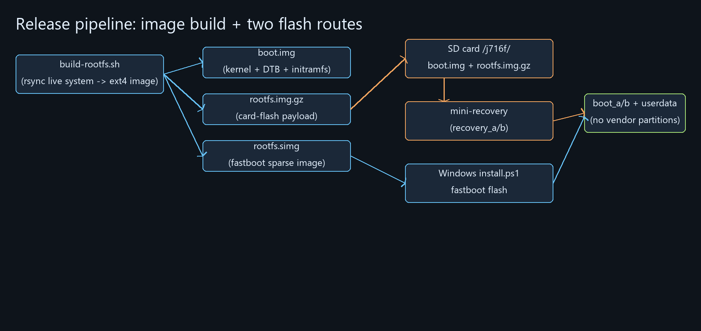
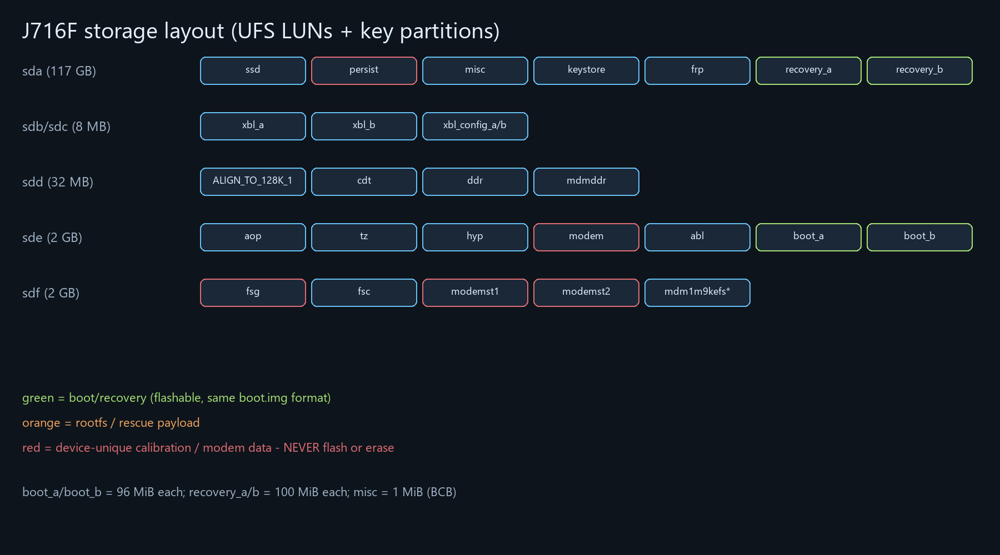
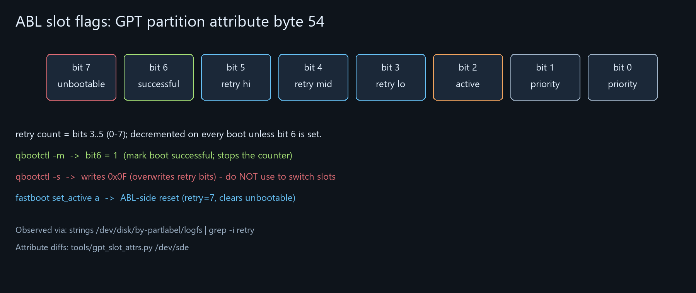
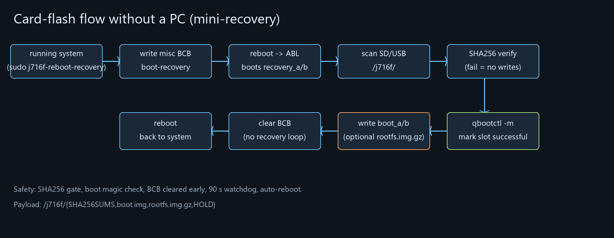

# 截图与示意图

以下图片均为实机/生成示意图，已对 Steam 登录二维码、个人头像等做打码处理。

## Steam Big Picture（登录页）

2560×1600 原生分辨率，gamescope DRM 直出；触屏 + 手柄可操作（二维码已打码）。

## Steam Big Picture（首页）

Steam-ARM 原生 aarch64 客户端 + Big Picture UI；头像已打码。

## 启动链

ABL → `boot_a/boot_b` 的 Android boot.img → 定制 initramfs → `sda18` rootfs → systemd → greetd/gamescope → Steam。
下方是 recovery / qbootctl / 卡刷相关的旁路工具。

## 发布与刷机流程

`build-rootfs.sh` 产出 `boot.img` / `rootfs.img.gz` / `rootfs.simg`，分别走 SD 卡 mini-recovery 卡刷和
Windows `install.ps1` 线刷；两者都只写 `boot_a/b` 与 `userdata`，不动 vendor 分区。

## 存储分区布局

绿色 = 可刷写（boot/recovery）；橙色 = rootfs/救援载荷；红色 = 设备唯一数据（persist/modem/fsg…），
**绝不覆盖**。

## ABL 槽位标志（GPT 属性 byte 54）

bits 3–5 = retry count，bit 6 = successful，bit 2 = active；`qbootctl -m` 置 bit6 解决"重启 7 次进 fastboot"。
详见 [docs/83](83-ABL计数彻底解决.md)。

## 无 PC 卡刷流程

写 BCB → ABL 引导 recovery → 扫描 SD `/j716f/` → 校验 → 写 boot/rootfs → 标记成功 → 清 BCB → 回系统。

> 这些图由 `tools/make-doc-images.py` 生成（截图来源为本项目实机记录；示意图为 Pillow 绘制）。
